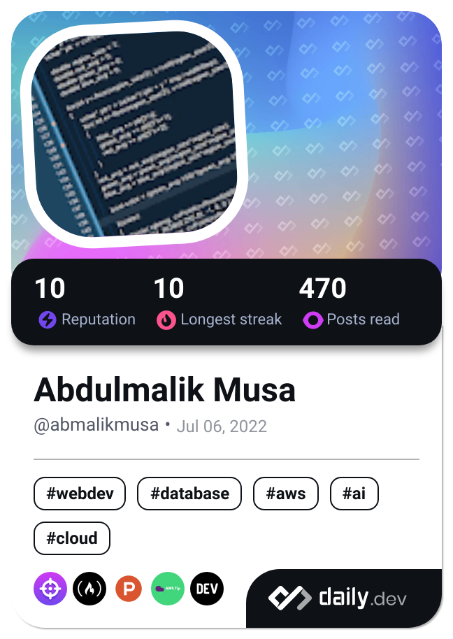

# 👋 Hi there, I'm Abdulmalik Musa

<h3 align="left">Engineering Leader • Software Architect • Product Builder</h3>

I'm passionate about building scalable software, leading high-performing engineering teams, and turning complex business challenges into elegant technology solutions.

With experience spanning enterprise software development, identity and access management, backend architecture, DevOps, cloud infrastructure, and product strategy, I enjoy building systems that are secure, scalable, maintainable, and impactful.

I believe software engineering is about more than writing code—it's about solving meaningful problems, empowering people, and building technology that creates lasting value.

---

## 🚀 What I Do

- 🏗️ Architect scalable enterprise applications and distributed systems
- 🔐 Build secure Identity & Access Management (IAM) solutions
- ⚙️ Design and develop enterprise-grade REST APIs and microservices
- ☁️ Design cloud-ready deployment architectures and engineering workflows
- 📊 Transform business requirements into reliable technical solutions
- 👥 Lead engineering teams, mentor developers, and improve engineering culture
- 🤖 Explore practical AI applications that improve engineering productivity
- 💡 Bridge the gap between business strategy and technical execution

---

# 🛠 Tech Stack

### Languages

### Backend

### Frontend

### Databases

### DevOps & Cloud

### Tools

---

## 🚧 Currently Building

- 🔐 Enterprise Identity & Access Management solutions
- 🤖 AI-assisted engineering workflows
- ⚡ Scalable backend platforms
- 🏛️ Modern enterprise architecture
- 🚀 Developer productivity solutions

---

## 🌱 Currently Exploring

- Artificial Intelligence Engineering
- Platform Engineering
- Software Architecture
- Engineering Leadership
- Product Strategy
- Developer Experience (DevEx)
- Distributed Systems
- Cloud-native Applications

---

## 🤝 Open To Collaborate On

- Enterprise Software
- Open Source Projects
- AI Engineering
- Backend Development
- Product Development
- Software Architecture
- Engineering Leadership
- Technical Mentorship

---

## 📊 GitHub Analytics

---

## 📈 Contribution Graph

---

## 🏆 GitHub Trophies

---

## 💬 Let's Connect

I'm always happy to connect with engineers, founders, product leaders, and technology enthusiasts.

- 💼 **LinkedIn:** https://www.linkedin.com/in/musaabdulmalik/
- 📧 Feel free to reach out for collaboration, mentorship, or interesting engineering conversations.

---

## 💡 Philosophy

> *"Build software that lasts. Lead people that grow. Never stop learning."*

---

